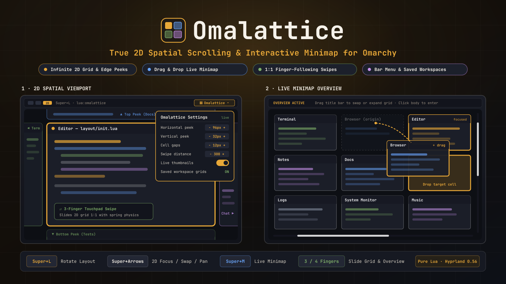

# Omalattice

**True 2D spatial scrolling and an interactive live-thumbnail minimap for Omarchy & Hyprland.**

[](https://github.com/MaCleodWalker/omalattice/actions/workflows/tests.yml)
[](LICENSE)



Omalattice turns any Hyprland workspace into an expandable two-dimensional lattice of tiled windows that you can navigate, rearrange, and swipe through in every direction. Unlike column-only scrolling tapes, windows live above, below, left, and right of each other—keeping related terminals, editors, browsers, and docs spatially grouped instead of buried down a single ribbon.

New windows automatically claim an open neighbor cell next to the focused window (`right → down → left → up`), expanding the 2D grid naturally before ever shifting an existing row. Configurable 4-way edge peeks keep adjacent rows and columns visible at the screen edges so you always feel the shape of your workspace.

Originally forked from [Hyprscroll2D](https://github.com/kirollosatef/hyprscroll2d) by kirollosatef (see [Credits](#credits)), Omalattice is purpose-built for Omarchy with a live drag-and-drop thumbnail minimap, 1:1 finger-following touchpad physics, persistent workspace grids, and a live bar settings menu.

## Highlights

- **Infinite 2D Spatial Grid & 4-Way Edge Peeks**
  - Move focus, pan the camera, or move and collision-swap windows across both axes (`Super+Arrow`, `Super+Shift+Arrow`, `Super+Ctrl+Arrow`).
  - Smart 4-way neighbor placement (`right`, `down`, `left`, `up`) fills adjacent free cells first, and empty rows or columns automatically compact away when windows close or move.
  - Independent width and height presets let you size windows on either axis, from framed 4-way edge peeks (`peek_x` / `peek_y`) down to seamless zero-gap, edge-to-edge tiling.
  - Debounced hover-focus (`hover_focus_delay`) centers the pointer when selecting an edge peek without accidentally scrolling the grid as your mouse crosses screen edges.

- **Interactive Live-Thumbnail Minimap (`Super+M`)**
  - Powered by Quickshell `ScreencopyView`, every window renders as a live, scaled-down thumbnail with its title bar—real windows keep their full geometry and never reflow while the overview is open.
  - **Drag and drop by the title bar** to rearrange your workspace directly in the minimap: drop onto an occupied cell to swap windows, drop onto an empty cell to move there, or drop past the outer edge to create a new row or column.
  - Click any thumbnail body (or press `Super+Enter`) to jump straight into that window.
  - Large workspaces never crush thumbnails below a readable minimum size (`overview_min_width` / `overview_min_height`); instead, the minimap scrolls smoothly via mouse wheel, touchpad, arrow selection, or viewport-edge autoscroll.

- **Fluid 1:1 Finger-Following Touchpad Gestures**
  - **Three-finger swipes** (horizontal and vertical) slide the 2D grid directly under your fingers, settling onto the nearest window or flicking to the next with soft boundary spring-back at the ends of a row or column.
  - **Four-finger vertical swipes** smoothly grow the live overview out of your windows as you swipe up and shrink it back into place as you swipe down.
  - Automatically swaps Hyprland's horizontal workspace swipe for 2D grid sliding only while an Omalattice workspace is focused, and respects your touchpad's `natural_scroll` setting.

- **Zero-Config Omarchy Integration**
  - **Instant `Super+L` Layout Rotation**: Joins Omarchy's native workspace layout cycle (`dwindle → scrolling → Omalattice → dwindle`) on a per-workspace basis—nothing changes on workspaces where you haven't enabled it.
  - **Live Omarchy Bar Settings Menu**: Includes a native bar widget (`󰕰`) with steppers and toggles for peeks, gaps, size presets, minimap options, and gestures that save to `~/.config/omalattice/config.lua` and apply immediately.
  - **Persistent Workspace Grids**: Remembers which workspaces use Omalattice and saves each workspace's 2D cell coordinates, size presets, and camera position across Hyprland reloads and restarts, matching windows back to their cells by class and title.
  - **Pure Lua Engine**: Uses Hyprland's native `hl.layout.register` Lua API—no compiled C++ plugin to rebuild on compositor updates, and all keybindings cleanly fall back to Omarchy's defaults outside Omalattice.

## Compatibility

`v0.3.0` targets Omarchy Quattro and Hyprland `0.56.x` (live-tested on Hyprland `0.56.2`). It is opt-in per workspace: nothing changes until you rotate a workspace into the layout with `Super+L`.

Because Omalattice runs on Hyprland's Lua custom-layout API and Omarchy's Quickshell service layer, it loads at runtime without editing your Hyprland config files and stays active across config reloads. Other Lua-configured Hyprland setups can also load the core layout engine and provide their own bindings.

## Install on Omarchy

### Recommended: Omarchy plugin command

Requirements:

- Current Omarchy Quattro with Hyprland `0.56.x`

Install and enable directly from GitHub:

```bash
omarchy plugin add https://github.com/MaCleodWalker/omalattice --enable
```

The plugin loads Omalattice at runtime without editing your Hyprland config.
It adds the layout to Omarchy's `Super+L` workspace layout rotation, so you can
use it on any workspace (see [Controls](#controls)). Workspaces you rotate into
the layout are remembered across Hyprland reloads and restarts. To pin the
layout to one workspace at startup instead, set `workspace` in
[`layout/config.lua`](layout/config.lua).

Update it later with:

```bash
omarchy plugin update io.github.macleodwalker.omalattice
```

The repository contains a validated Omarchy `manifest.json` and can be
installed through the official `omarchy plugin` command. A listing on the
community [Omarchy Plugin Marketplace](https://plugins.omarchy.org/) is a
separate review process and does not make a plugin part of Omarchy's bundled
first-party plugins.

### Requirements and dependencies

- Omarchy Quattro with its shell (`omarchy-shell`, built on Quickshell) and
  Hyprland `0.56.x`. The thumbnail overview uses Quickshell's screen capture
  and needs the shell service; see `overview_thumbnails` to opt out.
- `hyprctl`, `omarchy-notification-send` and
  `omarchy-hyprland-workspace-layout-toggle`, all installed with Omarchy.
- No other packages, no network access, no elevated privileges and no data
  collection.

### What it changes

The plugin only acts at runtime and never edits your Hyprland or Omarchy
configuration files.

- It registers the `omalattice` layout and replaces some Omarchy keybindings
  with versions that fall back to the original action outside the layout. It
  rebinds `Super+L` to add Omalattice to the layout rotation, and adds
  three-finger grid swipes and four-finger overview swipes. While an Omalattice workspace is active it also
  switches Hyprland's `follow_mouse` to click-to-focus and focuses hovered
  windows itself after a short delay. Scroll binds are active only while an overview
  is open.
- It stores the workspaces you rotated into the layout in
  `~/.local/state/omalattice/workspaces`, each workspace's grid (window class,
  title, cell and size preset) in `~/.local/state/omalattice/layouts`, and the
  overview state in `$XDG_RUNTIME_DIR/omalattice-overview` and
  `$XDG_RUNTIME_DIR/omalattice-overview-progress`.
- It runs `hyprctl` and `omarchy-notification-send` locally.

[Uninstalling](#uninstall) removes all of it.

### Alternative: config installer

If your Omarchy version does not yet provide `omarchy plugin`, clone the
project and run the config installer:

```bash
git clone https://github.com/MaCleodWalker/omalattice.git \
  ~/.local/share/omalattice
~/.local/share/omalattice/install.sh
```

This alternative installer does not pin a workspace by default. Passing a
workspace number pins that workspace to the layout for this installation:

```bash
~/.local/share/omalattice/install.sh 8
```

The installer:

- creates a timestamped backup of `~/.config/hypr/hyprland.lua`;
- loads Omalattice and its `Super+L` layout rotation;
- reloads Hyprland and checks for configuration errors;
- restores the backup automatically if the new block causes an error.

For a manual installation, add the following near the end of
`~/.config/hypr/hyprland.lua`, after the Omarchy defaults and your normal
`require("hypr.*")` lines:

```lua
local omalattice = os.getenv("HOME") .. "/.local/share/omalattice"
local omalattice_config = dofile(omalattice .. "/layout/config.lua")
dofile(omalattice .. "/layout/init.lua")
dofile(omalattice .. "/integration/omarchy.lua")

-- Restore workspaces that were rotated into the layout with Super+L.
dofile(omalattice .. "/integration/workspaces.lua").restore()

-- Optional: pin one workspace to the layout.
-- hl.workspace_rule({ workspace = "9", layout = "lua:omalattice" })
```

Then reload and validate the configuration:

```bash
hyprctl reload
hyprctl configerrors
```

If `hyprctl configerrors` prints nothing, the manual setup is ready.

## Controls

| Action | Binding |
| --- | --- |
| Focus a window | `Super+Arrow` |
| Move or swap a window | `Super+Shift+Arrow` |
| Pan the camera | `Super+Ctrl+Arrow` |
| Grow window width | `Super+-` |
| Shrink window width | `Super+=` |
| Grow window height | `Super+Shift+=` |
| Shrink window height | `Super+Shift+-` |
| Rotate workspace layout (dwindle, scrolling, Omalattice) | `Super+L` |
| Toggle workspace overview | `Super+M` |
| Select the focused overview window | `Super+Enter` |
| Exit overview | `Super+Escape` |
| Open the overview (follows the fingers) | Four-finger swipe up |
| Close the overview (follows the fingers) | Four-finger swipe down |
| Slide the grid up/down to a window | Three-finger swipe up/down |
| Slide the grid left/right to a window | Three-finger swipe left/right |

The focus, move and resize bindings retain Omarchy's normal behavior whenever
the active window is not using Omalattice. `Super+Enter` selects the overview
window while overview is active and otherwise keeps Omarchy's terminal action.
Swipes follow your fingers. A three-finger swipe slides the whole grid as you
move, and when you lift your fingers it settles on the nearest window, or on the
next one after a short flick; the last window in a row or column gives a little
and springs back. A four-finger swipe up grows the overview out of your windows
as far as your fingers go, and a swipe down shrinks it back into them; lifting
past half way, or flicking, finishes the move. `swipe_distance` sets how far to
swipe for one window or the whole overview (default: `300`, the same as
Hyprland's workspace swipe; lower is faster). In an open overview a three-finger
swipe moves the selection one window instead.

Three-finger swipes work while Omalattice is active. Vertical swipes always do
this. All swipes follow your touchpad's `natural_scroll` setting: with it on,
the content follows your fingers, so swiping up reveals the window below; with
it off, the grid moves the other way. A horizontal swipe is normally taken by
Hyprland's workspace swipe, so on an Omalattice workspace Omalattice unsets
`hl.gesture({ fingers = 3, direction = "horizontal", action = "workspace" })`
and uses its own horizontal swipe instead; it restores the workspace swipe on
other workspaces. Hyprland cannot report which gestures exist, so this assumes
you have that exact workspace swipe: set `workspace_swipe = false` in
[`layout/config.lua`](layout/config.lua) if you do not, and the horizontal
swipe stays always on. Set `gesture_fingers` if your workspace swipe uses
a different finger count. A workspace swipe with extra options such as `scale`
or `mods` cannot be unset and keeps priority over the horizontal swipe.

Hovering a neighboring edge peek focuses that window and centers the cursor
inside it, so one mouse movement does not scroll through the whole row or column.
Focus follows the mouse only after the pointer has rested on a window for
`hover_focus_delay` milliseconds (150 by default), so moving across the edge
peeks no longer scrolls the grid. Set it to `0` to use Hyprland's immediate
`follow_mouse` behavior. The delay applies only while `input.follow_mouse` is
`1`, and is paused while a launcher holds the keyboard, a window is fullscreen or the
overview is open.

In overview mode, every window is shown as a live, scaled-down thumbnail with
its title across the top. Use `Super+Arrow` to select a window and
`Super+Enter` to return to it, or click a window directly to enter it.
Drag a thumbnail by its title bar to rearrange the minimap grid without leaving overview:
dropping on an occupied cell swaps the two windows, and dropping on an empty
cell moves the window there. The highlighted cell previews the destination.
Drop in the space beyond the grid to add an adjacent row or column; empty
rows and columns compact away, just as with keyboard moves. Hold near the
viewport edge to autoscroll a large grid. Releasing outside the viewport
cancels the move. Dragging preserves the selected window and size presets,
and the new arrangement is saved with the workspace layout. This requires
live thumbnails to be enabled.
The thumbnail body remains click-to-enter; it does not start a drag.
`Super+M` and `Super+Escape` also exit overview mode.

After installing an update that changes the Lua layout, relaunch Hyprland
to load the new layout handler. Restarting only the shell reloads the QML
but not the already-registered Lua code. Drag-and-drop needs both the
updated shell plugin and layout; if a drag has no highlighted destination,
the running layout may be missing its drop grid.

Thumbnails are drawn by the Omarchy shell service, so the real windows keep
their size and applications do not re-lay out while the overview is open.
Thumbnails never shrink below a quarter of the viewport in each direction.
When a workspace has too many windows to fit, the overview scrolls instead:
scroll bars appear along the edges, the mouse wheel or touchpad scrolls the map,
and selecting a window with the arrow keys scrolls it into view. Scrolling is
only captured while an overview is open.

Move the mouse to the edge of the viewport to pan a scrollable overview
automatically; it speeds up toward the edge and stops at the end of the
content (`overview_autoscroll_speed`, `0` to disable). Clicking a thumbnail
enters that window, closes the overview and moves the pointer into the window.

Without the shell service, set `overview_thumbnails = false` in
[`layout/config.lua`](layout/config.lua). The overview then resizes the real
windows instead, so their contents respond to the smaller size according to
each application's normal resize behavior. The Lua custom-layout API cannot
uniformly scale a client's rendered pixels.

## Customize the layout

### Saved grids

Each workspace's grid is saved whenever it changes: which cell every window
sits in, its width and height preset and the camera position. After Hyprland
restarts, windows are matched to their saved cells by class, preferring the same
title, and cells wait up to 45 seconds for slow-starting apps. Delete
`~/.local/state/omalattice/layouts` to forget them.

### Bar menu

The plugin adds an Omalattice widget to the Omarchy bar. Add it from the bar
settings, then click it to change the peeks, gaps, size presets, overview and
input options with `-`/`+` steppers and switches. Changes are saved to
`~/.config/omalattice/config.lua` and applied to the layout straight away,
except the input options (`hover_focus_delay`, `gesture_fingers`,
`overview_gesture_fingers` and `workspace_swipe`), which need a Hyprland restart. The file only holds values
that differ from the defaults, survives plugin updates and can be edited by
hand; `OMALATTICE_CONFIG` overrides its location. It applies to plugin
installs, not the config installer.

### Config file

Edit [`layout/config.lua`](layout/config.lua) (the defaults) to change:

- `workspace` (optional): workspace number pinned to Omalattice at startup;
  unset by default, so workspaces opt in with `Super+L`
- `peek_x` and `peek_y`: visible pixels from neighboring columns and rows
  (default: `96` and `32`; at `0` the full-cell window fills the whole area).
  When both the peek and gap for an axis are `0`, it reaches the display's
  usable edges, ignoring Hyprland's outer gaps but respecting reserved bar space.
- `gap_x` and `gap_y`: spacing between cells. At `0`, neighboring windows
  touch without extra spacing from Hyprland's inner gaps or border.
- `width_steps` and `height_steps`: available size presets
- `default_width_step` and `default_height_step`: initial window dimensions
  (default: the largest preset, which fills the area left by the peeks)
- `hover_focus_delay`: milliseconds the mouse must rest on a window before it
  takes focus (default: `150`; `0` disables the delay)
- `gesture_fingers`: finger count for the grid swipes (default: `3`)
- `swipe_distance`: touchpad travel, in Hyprland's swipe units, that slides the
  grid one window or fully opens the overview (default: `300`; lower is faster)
- `overview_gesture_fingers`: finger count for the swipe up/down that opens and
  closes the overview on an Omalattice workspace (default: `4`; `0` disables;
  must differ from `gesture_fingers`)
- `workspace_swipe`: whether you have a horizontal workspace swipe for the
  left/right focus swipes to replace on Omalattice workspaces (default: `true`)
- `overview_thumbnails`: draw live thumbnails in the overview (default: `true`)
- `overview_autoscroll_speed`: pixels per second the overview pans at the edge
  of the viewport (default: `900`; `0` disables)
- `overview_min_width` and `overview_min_height`: smallest overview window cell,
  as a fraction of the viewport (default: `0.25`)

Reload Hyprland after changing the values. Values in
`~/.config/omalattice/config.lua` take precedence over these defaults.

## Update a config installation

```bash
git -C ~/.local/share/omalattice pull --ff-only
hyprctl reload
hyprctl configerrors
```

## Uninstall

If installed using `omarchy plugin add`, run:

```bash
omarchy plugin remove io.github.macleodwalker.omalattice --yes
hyprctl reload
```

The reload restores Omarchy's normal bindings and removes the runtime layout.

If installed using the alternative config installer, run its uninstaller
before deleting the repository:

```bash
~/.local/share/omalattice/uninstall.sh
```

It removes only the marked Omalattice block and creates another timestamped
config backup. Once it finishes, remove the cloned repository:

```bash
rm -rf ~/.local/share/omalattice
```

## Known limitations

- Saved grids match windows back to their cells by class and title; multiple
  windows with identical classes and titles on the same workspace are assigned
  in creation order.
- Fullscreen, groups, multi-monitor moves, and special workspaces need more
  testing.
- The bundled conditional keybinding integration and live thumbnail overview
  target Omarchy.
- Compatibility outside Hyprland `0.56.x` is not yet guaranteed.

Please report issues with your Hyprland version, monitor geometry, relevant
configuration, and exact reproduction steps.

## Development

Run the full test and syntax suite:

```bash
make check
```

The geometry and navigation engine is isolated from Hyprland APIs so it can be
tested with plain Lua. See [`docs/DESIGN.md`](docs/DESIGN.md) for the behavioral
model and roadmap, and [`docs/RESEARCH.md`](docs/RESEARCH.md) for related
projects, important differences and technical background.

## Contributing

Contributions and real-world testing are welcome. Read
[`CONTRIBUTING.md`](CONTRIBUTING.md) before opening a pull request.

## Credits

Omalattice is a fork of [Hyprscroll2D](https://github.com/kirollosatef/hyprscroll2d)
by [kirollosatef](https://github.com/kirollosatef), whose two-dimensional grid,
camera and layout engine it builds on. It is maintained separately by
[MaCleod Walker](https://github.com/MaCleodWalker) and adds the interactive
live-thumbnail minimap with title-bar drag-and-drop, 1:1 finger-following
touchpad gestures, persistent workspace grids, the Omarchy bar settings menu,
`Super+L` layout rotation, smart 4-way neighbor placement, debounced hover
focus, and compacted/gap-free grids.

## License

[MIT](LICENSE). The original work is copyright kirollosatef and its
contributors; Omalattice's additions are copyright MaCleod Walker and
Omalattice contributors.
